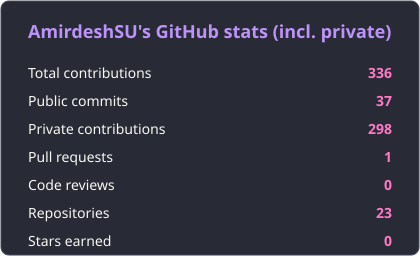

<div align="center">


<a href="https://github.com/AmirdeshSU">
  
</a>

<br/>


</div>

---

## `> cat about.txt`

```text
name      : Amirdeshwara R
role      : Security Testing Engineer @ Secure Network Solutions (SNS) India
location  : Chennai, India
focus     : Security automation: tools that cut manual VAPT and SOC reporting
edge      : Offensive testing with a defender's view from SOC operations
learning  : OSCP, C3SA, AI/GenAI for Cybersecurity (IIT Roorkee)
```

I automate the repetitive work in security: vulnerability reporting, alert triage, pentest checks and daily customer reports. The tools below are built from daily use on a real SOC and VA team.

---

## ⚡ Featured: Security Automation

### 🤖 Groot — SOC Operations Platform *(private)*
Role-based platform that runs a SOC's day-to-day workflow.
- **Ticket triage** from Zoho Desk, with **SLA-breach reporting** and **shift rosters**
- **AI-assisted incident analysis**: per-user encrypted keys, PII masked before model calls, FortiSIEM integration, multi-provider threat intel
- **Daily customer reports** with PDF export, generated automatically every night
- Tested with pytest and Playwright E2E, and hardened by pentesting it myself

`FastAPI` `React` `TypeScript` `PostgreSQL` `Docker`

### 📊 VA Report Tools *(private)*
Turns a manual Nessus reporting cycle into a pipeline.
- Bulk-downloads scans through the Nessus REST API
- Consolidates scan CSVs and builds **per-IP Excel workbooks**
- Tags rescans as **New / Closed / Open**
- Scan scheduler with active-hours control and liveness checks, plus a standalone PyInstaller build

`Flask` `Python` `Docker`

### 🎯 NetPentest *(private)*
Automated network pentest covering **all 10 OWASP Network Top 10 categories (N1–N10)**.
- Parallel module execution
- Single IP, CIDR or target-list input
- **TXT, JSON and interactive HTML** reports

`Python`

### 🧪 OpenAEV Ransomware Tabletop
Deployed OpenAEV in Docker with IMAP and SMTP mail flow, built custom **Akira ransomware** scenarios, and ran the exercise for the whole SOC team.

`OpenAEV` `Docker`

### 🔧 More automation
- 🔍 [Nessus-Report-Downloader](https://github.com/AmirdeshSU/Nessus-Report-Downloader) — bulk-download Nessus scan reports (`Python`)
- 🗓️ [SOC-Roaster](https://github.com/AmirdeshSU/SOC-Roaster) — shift roster tooling for SOC teams
- 🧩 FortiSIEM custom XML parsers for better detection fidelity, and OpenCTI connector management
- 🧠 [Skills](https://github.com/AmirdeshSU/skills) — my Claude Code skills and plugin index

---

## `> cat stack.conf`

<div align="center">


</div>

| | |
|---|---|
| **Automation and AI** | Python, FastAPI, Flask, Claude Code, Antigravity, Google AI tools |
| **Offensive** | Nmap, Burp Suite, Wireshark, Nessus (SME), GoPhish |
| **Defensive** | FortiSIEM, Seceon, OpenCTI, OpenAEV, threat hunting, incident investigation |
| **Infrastructure** | Windows Server, Active Directory, CCNA trained |

## `> cat track-record.txt`

| | |
|---|---|
| 🔎 **Vulnerability assessment** | 20+ VA reports across 1500+ machines for 15+ clients |
| 🛡️ **SOC operations** | 2000+ incidents handled as SPOC (FortiSIEM, Seceon) |
| 🎣 **Social engineering** | GoPhish and uPhish campaigns, 6000+ emails sent for one client |

## `> cat certs.txt`

- 🎓 **CEH** — EC-Council
- 🚧 **OSCP** — Offensive Security (in progress)
- 🚧 **C3SA** — CyberWarFare Labs (in progress)
- 🚧 **PG Certificate in AI/GenAI for Cybersecurity** — IIT Roorkee CEC (ongoing)
- 🎓 **B.Tech, Computer Science and Engineering** — SASTRA Deemed University

## `> git log --stats`

<div align="center">




</div>

## `> ./connect.sh`

<div align="center">

<a href="https://www.linkedin.com/in/amirdeshr/"></a>
<a href="mailto:amirdesh61@gmail.com"></a>
<a href="https://github.com/AmirdeshSU"></a>

<br/><br/>


</div>
